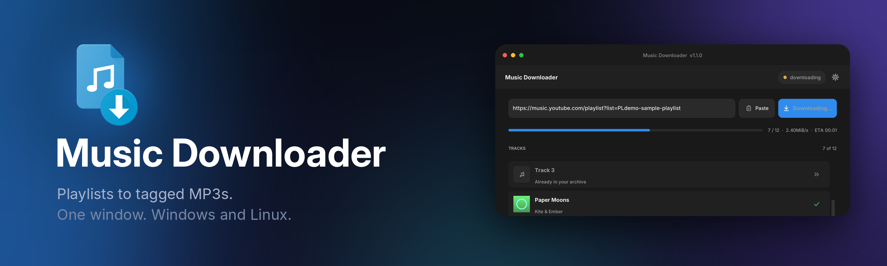
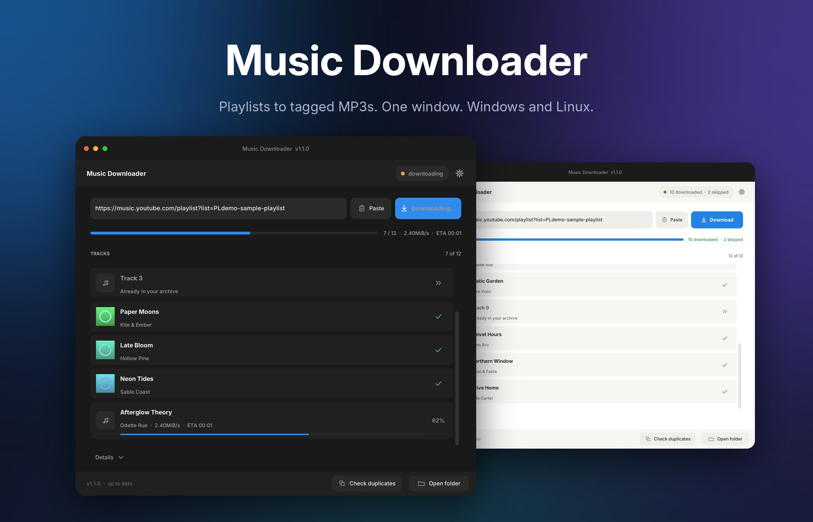
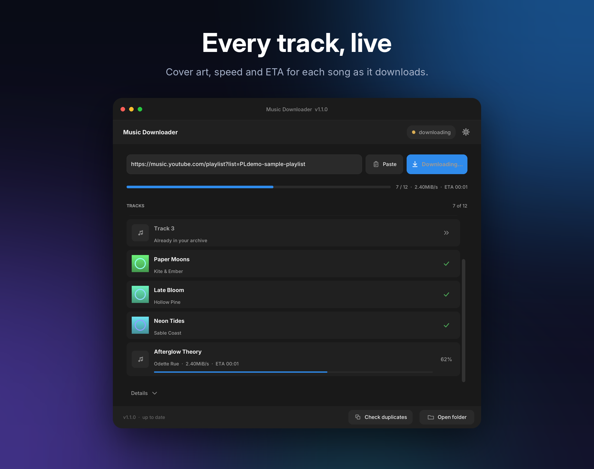
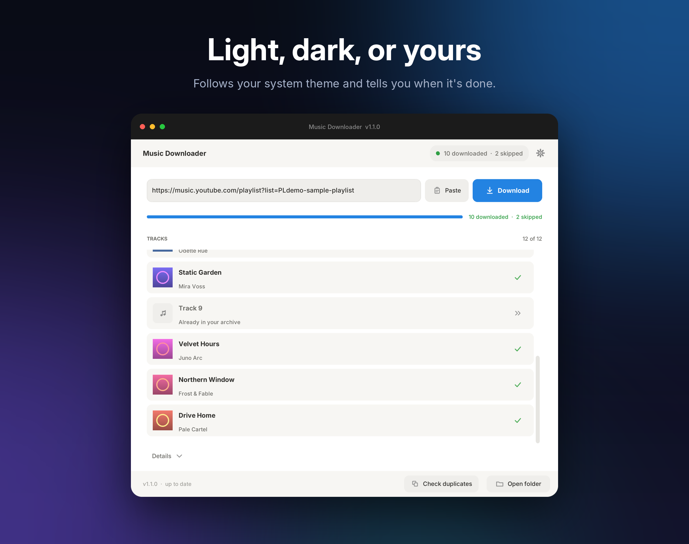
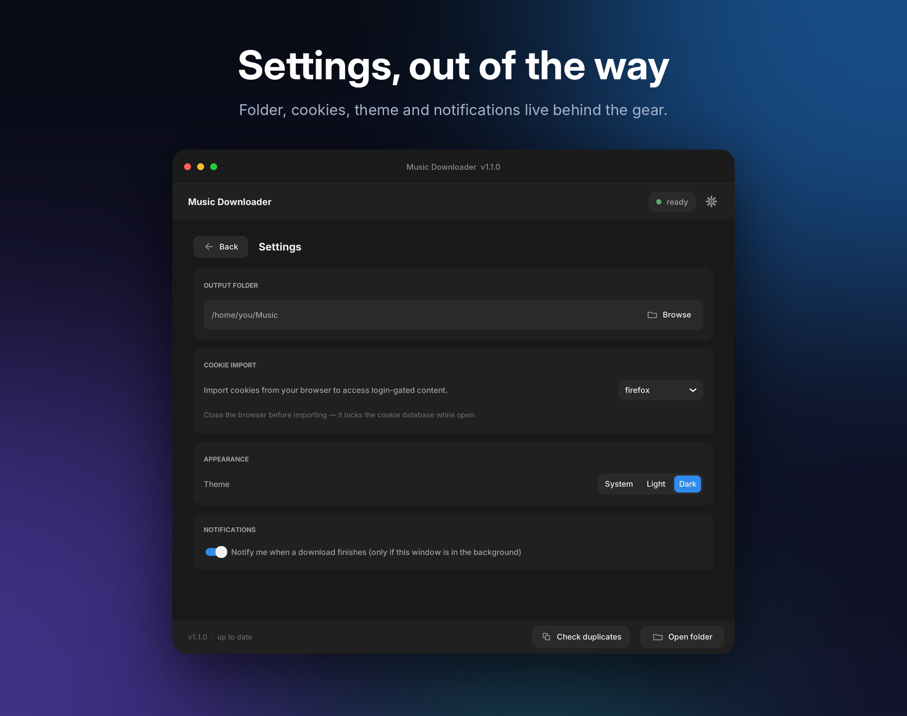
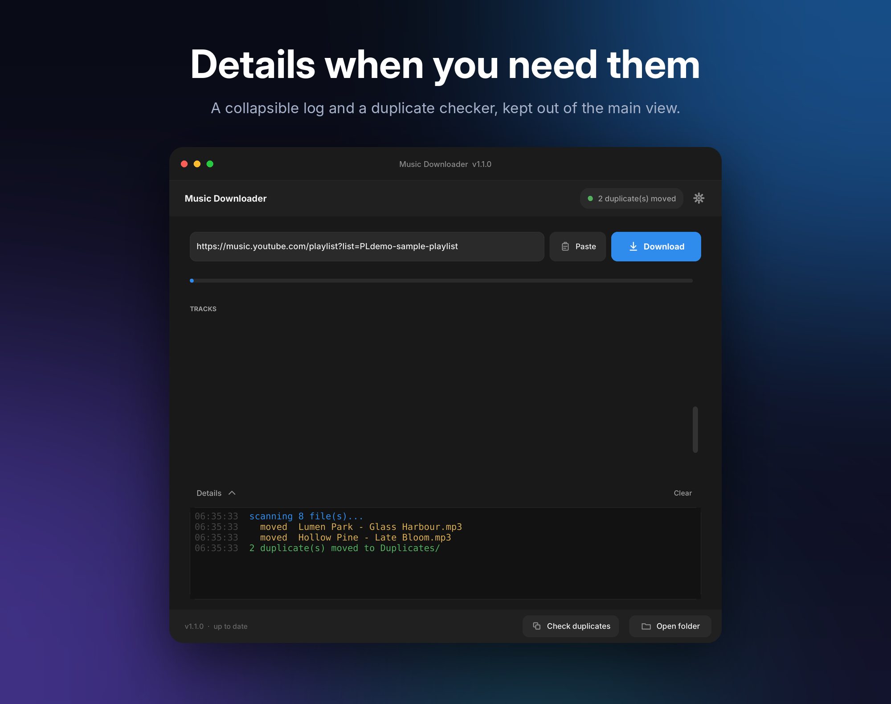

<p align="center">
  
</p>

<p align="center">
  <a href="https://github.com/TomceGraphics/music-downloader/releases/latest"></a>
  <a href="https://github.com/TomceGraphics/music-downloader/actions/workflows/release.yml"></a>
  <a href="https://github.com/TomceGraphics/music-downloader/releases"></a>
  <a href="LICENSE"></a>
  
  
  
  
  
</p>

<p align="center"><b>Paste a playlist link. Get tagged MP3s with cover art.</b><br>
A small, fast desktop app on top of <a href="https://github.com/yt-dlp/yt-dlp">yt-dlp</a> and <a href="https://ffmpeg.org">FFmpeg</a>, for Windows and Linux.</p>

<p align="center">
  
</p>

> **Before you use it:** only download content you have the right to download. See [Legal](#legal--disclaimer).

## Features

| | |
|---|---|
| **Live track list** | Every song gets a row with cover art, artist, speed, ETA and a state (downloading, done, skipped, failed). A thin overall bar tracks the whole playlist. |
| **Tagged MP3s** | Best-quality audio converted to MP3 with title, artist and cover art embedded. |
| **Paste and go** | Big link field with a Paste button. Copy a YouTube link, come back to the window, and it drops in if the field is empty. |
| **Never twice** | An `archive.txt` remembers what you already downloaded; repeat runs skip those tracks and say so. |
| **Duplicate checker** | Finds repeats by artist and title and moves them to `Duplicates/`. It never deletes anything. |
| **Bring your own login** | Import cookies from Firefox, Chrome, Edge, Brave, Chromium, Opera or Vivaldi. If that fails, it retries without cookies. |
| **Light and dark** | Follows your system theme, or pick one in Settings. Bundled Inter font, so it looks the same on every machine. |
| **Quiet by default** | Settings live behind the gear (`Ctrl+,`, `Esc` to go back). The raw log is a collapsible "Details" drawer that turns amber when something needs a look. |
| **Done notification** | A desktop notification when a download finishes while the window is in the background (`notify-send` on Linux, a toast on Windows). |
| **Self-contained** | Fetches yt-dlp, FFmpeg and a JS runtime on first run, keeps yt-dlp updated, prefers your system copies. |
| **Extensible** | Every feature is one small file. See [docs/ADDING_A_FEATURE.md](docs/ADDING_A_FEATURE.md). |

<p align="center">
  
  
  
  
</p>
<p align="center"><sub>Screenshots are rendered from the real UI by <code>tools/make_screenshots.py</code> with staged sample data (fictional artists and generated cover art).</sub></p>

## Install

Download the latest build from the [Releases page](https://github.com/TomceGraphics/music-downloader/releases/latest). Every release has a `SHA256SUMS` file.

### Windows
1. Download `music-downloader-vX.Y.Z-windows-x64.zip` and extract it anywhere.
2. Run `music-downloader.exe`.

The app is not code-signed, so Windows SmartScreen may say "Windows protected your PC". Choose **More info → Run anyway**, and compare the zip's hash with `SHA256SUMS` first:
`Get-FileHash .\music-downloader-*.zip -Algorithm SHA256`

### Linux (Fedora, Ubuntu, ...)
```bash
tar xzf music-downloader-vX.Y.Z-linux-x86_64.tar.gz
cd music-downloader-vX.Y.Z-linux-x86_64
./install.sh            # no sudo: installs to ~/.local, adds a menu entry and a `music-downloader` command
```
Uninstall with `./install.sh --uninstall` (your music and settings are left alone). Prefer not to install? Run `app/music-downloader` directly.
The Linux build needs glibc 2.35 or newer (Fedora 36+, Ubuntu 22.04+, Debian 12+).

### First run
The app downloads what it needs into your user data folder: yt-dlp (about 41 MB), FFmpeg (about 120 MB download) and, only if you have no `deno`, `node` or `bun`, a Deno JS runtime that current YouTube extraction requires. The log shows progress.
Unpacked, that is roughly 470 MB (static FFmpeg builds are large). To avoid it, install FFmpeg (with MP3 support) and Node or Deno from your package manager; the app prefers system copies. Set `"fetch_deno": false` in the config to skip the Deno download.
> **Fedora note:** the stock `ffmpeg-free` package cannot encode MP3. The app detects that and falls back to its own copy. With RPM Fusion's full `ffmpeg` it uses the system one.

## Where your data lives

| | Linux | Windows |
|---|---|---|
| Settings (`config.json`) | `~/.config/music-downloader/` | `%APPDATA%\MusicDownloader\` |
| Downloaded tools | `~/.local/share/music-downloader/bin/` | `%LOCALAPPDATA%\MusicDownloader\bin\` |
| Music + `archive.txt` | your chosen output folder (default `~/Music`) | same |

Nothing user-specific is ever stored in the app folder or the repository.

Optional `config.json` keys: `appearance` (`system` / `light` / `dark`), `notify_when_done`, `browser_profile` (explicit browser profile path, needed for Flatpak browsers, e.g. `~/.var/app/org.mozilla.firefox/.mozilla/firefox/<profile>`), `prefer_system_binaries` (default `true`), `fetch_deno`, `check_updates`, and `ytdlp_path` / `ffmpeg_path` overrides.

## Run from source
```bash
# Fedora:  sudo dnf install python3-tkinter      Ubuntu/Debian:  sudo apt install python3-tk
git clone https://github.com/TomceGraphics/music-downloader && cd music-downloader
python3 -m venv .venv && source .venv/bin/activate      # Windows: .venv\Scripts\activate
pip install -r requirements.txt
python main.py
```

## Build
```bash
./build.sh      # Linux  -> dist/music-downloader-vX.Y.Z-linux-<arch>.tar.gz
build.bat       # Windows -> dist\music-downloader-vX.Y.Z-windows-x64.zip
```
Both use the same `music-downloader.spec` (onedir, no UPX, nothing heavy bundled: about 34 MB unpacked, 14 MB archive on Linux, including the Inter font). PyInstaller cannot cross-compile, so build each platform on that platform; CI does this for you.

## Cut a release
1. Bump `VERSION` in `core/version.py` and commit.
2. `git tag v1.0.1 && git push origin main v1.0.1`
3. [GitHub Actions](.github/workflows/release.yml) builds Windows and Linux, checks the tag matches `VERSION`, and publishes the release with `SHA256SUMS`.

A manual run of the workflow (Actions tab → *release* → *Run workflow*) builds without publishing.

## Troubleshooting
- **YouTube downloads fail or log "no JavaScript runtime":** install `deno` (or `node`), or let the app fetch Deno on first run.
- **Chrome/Edge cookies fail on Windows:** recent Chrome-family encryption blocks cookie reading. The app retries without cookies; Firefox is the reliable choice.
- **Flatpak Firefox/Chromium cookies:** set `browser_profile` (see above).
- **"Tkinter is missing":** `sudo dnf install python3-tkinter` (Fedora) or `sudo apt install python3-tk` (Ubuntu/Debian).

## Develop
- [ARCHITECTURE.md](ARCHITECTURE.md): modules and the `AppContext` API.
- [docs/ADDING_A_FEATURE.md](docs/ADDING_A_FEATURE.md) and [features/_template.py](features/_template.py): add a feature with one file and one registry line.
- Regenerate the images (needs Pillow): `python tools/make_icons.py`, then `xvfb-run -a -s "-screen 0 1800x1500x24" python tools/make_screenshots.py && python tools/make_banner.py`.

## Legal & disclaimer
Music Downloader is a front-end for [yt-dlp](https://github.com/yt-dlp/yt-dlp) and [FFmpeg](https://ffmpeg.org). It is not affiliated with or endorsed by YouTube, Google or any other service; those names are trademarks of their owners.

**You are responsible for how you use it.** Only download content you own, that is in the public domain, that is licensed for download, or that you otherwise have the right to copy, and comply with copyright law and the terms of service of the sites you use. Downloading may violate a service's terms even where the content is free to watch. Using browser cookies means the tool reads your browser's cookie store on your machine (nothing is uploaded by this app), and using a logged-in session for automated downloads may risk your account. The software is provided as is, without warranty (see `LICENSE`). This is not legal advice.

## License
[MIT](LICENSE). Third-party components and their licences: [THIRD_PARTY_NOTICES.md](THIRD_PARTY_NOTICES.md).
